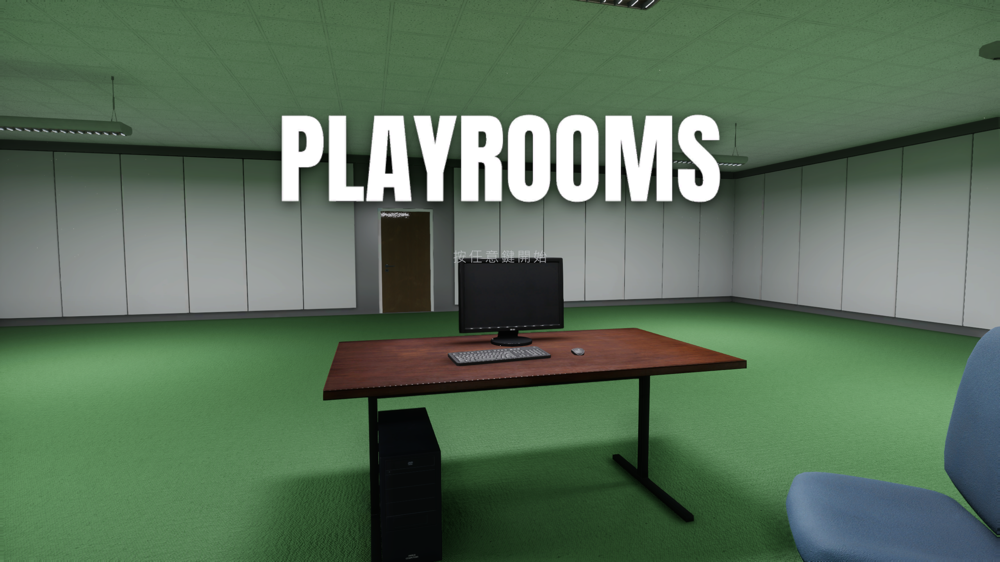

# Playrooms — Traditional Chinese Localization (unofficial)

English ・ [繁體中文](README.md)

An unofficial **Traditional Chinese (zh-Hant)** localization patcher for the Steam game
**Playrooms** (Two Pixels UG). It does not touch game logic — it only swaps the text
tables and the font assets, and it can be reverted at any time.



## Features

- **1439 strings translated**: UI 902, Balli dialogue 177, skills 152, items 97, mails 64, popups 47
- The in-game language selector shows **繁體中文** and the game boots in Chinese
- Mixed Latin + CJK text renders correctly (`light.exe`, `Balli`, `HUD`, `SMAA`, …)
- **Reversible**: originals are backed up on first run, `-Restore` brings English back
- **Idempotent**: every run starts again from the pristine backup
- Fully open: translations are plain TSV files you can edit

## Requirements

- Steam release of **Playrooms** (verified on Unity 6000.6.3 / game 1.0.2)
- Windows 10/11 (the patch uses the built-in *Microsoft JhengHei* font at runtime)
- Python 3.10+ (the script installs `UnityPy` automatically on first run)

This repository contains **no game assets** — only translations and tooling.

## Install (3 steps)

1. Download this repository (`Code` → `Download ZIP`, or `git clone`) and extract it.
2. Open a terminal in that folder and run:

   ```powershell
   powershell -ExecutionPolicy Bypass -File .\apply.ps1
   ```

   The script auto-detects the Steam install; if it fails, pass the folder explicitly:

   ```powershell
   powershell -ExecutionPolicy Bypass -File .\apply.ps1 -GameDir "D:\SteamLibrary\steamapps\common\Playrooms"
   ```

3. Launch the game from Steam — the UI is now in Traditional Chinese.

## Restore

```powershell
powershell -ExecutionPolicy Bypass -File .\restore.ps1
```

Originals live in `.backup\Playrooms\`.

## FAQ

**Steam verified my files / the game updated — the translation is gone.**
Just run `apply.ps1` again; the backup is kept in `.backup`.

**Why is there no English option in the language menu?**
The English locale slot is repurposed as 繁體中文 so the game starts in Chinese.
Run `restore.ps1` to get English back.

**Saves are untouched?**
Yes. Only files inside the install folder are modified, never
`%USERPROFILE%\AppData\LocalLow\Two Pixels UG (haftungsbeschränkt)\Playrooms\`.

**Why do the fonts look different?**
The three TMP font assets shipped with the game only contain baked Latin glyphs.
Chinese glyphs have to be generated at runtime, so the assets are switched to
`AtlasPopulationMode.DynamicOS` (Microsoft JhengHei). Change `FONT_FAMILY` in
`tools/patchlib.py` to use another installed font family.

## Editing the translation

`translations\zh-Hant\<Table>_en.tsv`, one entry per line: `id<TAB>text`.

- `\n` means a line break
- Keep placeholders such as `{0}`, `%%Price%%`, `%%Count%%`, `%%Key%%` and colour codes `^g` `^w`
- Re-run `apply.ps1` after editing

English sources are in `translations\en\`.

## How it works

1. The game stores its text in Unity Localization Addressables string tables (locale `en`).
   The patcher rewrites those tables with the Traditional Chinese strings.
2. Every TextMeshPro font asset becomes `DynamicOS` with a 2048² atlas, so CJK glyphs are
   rasterised from the OS font at runtime.
3. Addressables validates a CRC per bundle, so the corresponding `catalog.bin` entries are
   zeroed (validation disabled for those bundles only).

See [docs/技術說明.md](docs/技術說明.md) (Chinese) for the full write-up.

## License

- Code: [MIT](LICENSE)
- Translations: CC BY 4.0
- *Playrooms* and all its assets/trademarks belong to **Two Pixels UG (haftungsbeschränkt)**.
  This is an unofficial fan project, unaffiliated with the developer, intended for personal
  use with a legitimately owned copy. It will be taken down upon request by the rights holder.
