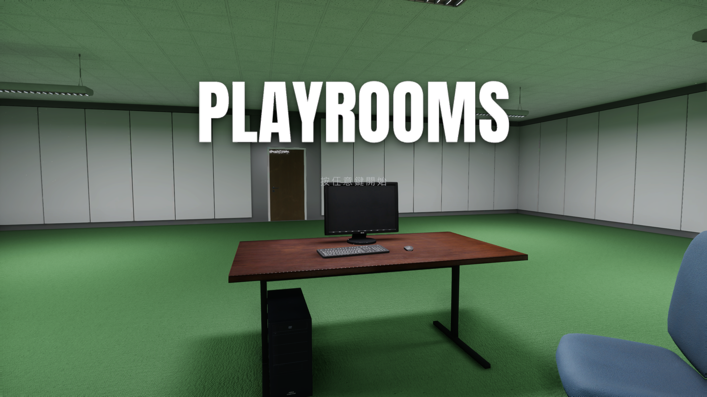
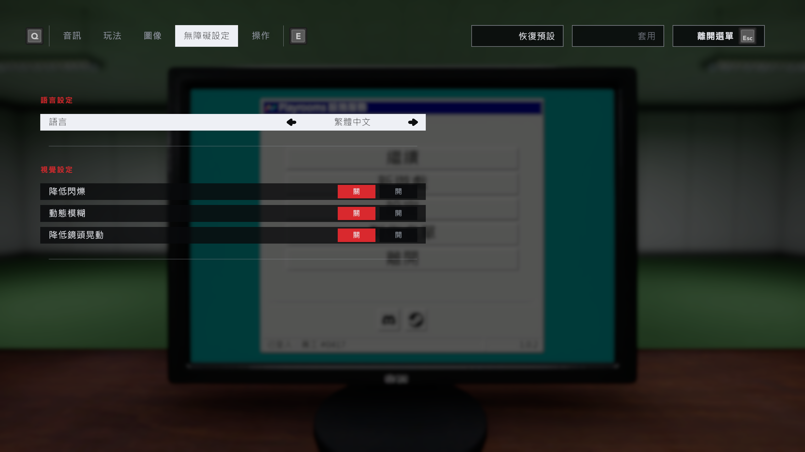
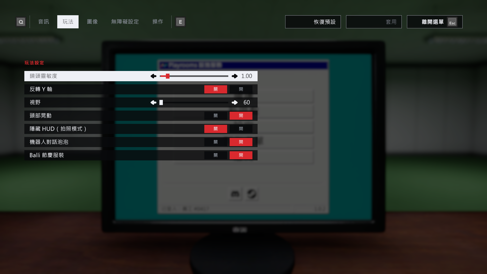

# Playrooms 繁體中文漢化（非官方）

[English](README.en.md) ・ 繁體中文

給 Steam 遊戲 **Playrooms**（Two Pixels UG）使用的繁體中文漢化工具。
不改動遊戲程式邏輯，只替換文字資料與字型設定，隨時可一鍵還原。



| 語言選單 | 設定頁 |
|---|---|
|  |  |

## 特色

- **全介面繁中**：共 **1439 條**字串 —— 一般介面 902、Balli 對話 177、技能 152、物品 97、郵件 64、彈窗 47
- **語言選單顯示「繁體中文」**：啟動遊戲即為中文，不用另外切換
- **中文與英數混排正常**：字型改為動態產生（微軟正黑體），`light.exe`、`Balli`、`HUD`、`SMAA` 這類字樣照樣顯示
- **可逆**：第一次執行會自動備份原始檔案，`-Restore` 一鍵回英文版
- **可重複執行**：每次都是從乾淨備份重新套用，不會愈改愈亂
- **開源可改**：譯文是純文字 TSV，想改哪句就改哪句

## 需求

| 項目 | 說明 |
|---|---|
| 遊戲 | Steam 版 **Playrooms**（Unity 6000.6.3 / 遊戲版本 1.0.2 測試通過） |
| 系統 | Windows 10 / 11（中文顯示依賴內建的「微軟正黑體」） |
| 執行環境 | Python 3.10 以上（第一次執行會自動安裝 `UnityPy`） |

> 本專案**不包含**任何遊戲檔案，只包含翻譯文字與處理腳本。

## 安裝（3 步）

1. 下載本專案（`Code` → `Download ZIP`，或 `git clone`）並解壓縮。
2. 在資料夾上按右鍵 →「**在終端機中開啟**」，執行：

   ```powershell
   powershell -ExecutionPolicy Bypass -File .\apply.ps1
   ```

   腳本會自動尋找 Steam 安裝路徑；找不到時會請你貼上遊戲資料夾
   （例如 `D:\SteamLibrary\steamapps\common\Playrooms`）。

3. 從 Steam 啟動遊戲，介面即為繁體中文。

指定路徑的寫法：

```powershell
powershell -ExecutionPolicy Bypass -File .\apply.ps1 -GameDir "D:\SteamLibrary\steamapps\common\Playrooms"
```

## 還原成英文版

```powershell
powershell -ExecutionPolicy Bypass -File .\restore.ps1
```

或 `.\apply.ps1 -Restore`。原始檔案保存在 `.backup\Playrooms\`。

## 常見問題

**Q：Steam 驗證檔案完整性 / 遊戲更新後，中文不見了？**
重跑一次 `apply.ps1` 即可。更新會覆蓋被修改的檔案，備份仍在 `.backup`。

**Q：語言選單裡為什麼沒有 English？**
本漢化把英文語言欄位直接換成繁體中文（這樣啟動就是中文）。
要用英文請 `-Restore` 還原，或自行在 `translations\zh-Hant\` 保留原文。

**Q：遊戲存檔會受影響嗎？**
不會。腳本只動遊戲安裝目錄裡的資源檔，不碰
`%USERPROFILE%\AppData\LocalLow\Two Pixels UG (haftungsbeschränkt)\Playrooms\`。

**Q：中文的字型跟原本的像素字型不一樣？**
原本三套 TMP 字型（VT323 / Roboto Condensed / Anton）只烘焙了拉丁字母，
中文必須在執行時產生，因此改為動態字型（微軟正黑體）。
想要更貼近原始風格，可自行把 `tools\patchlib.py` 的 `FONT_FAMILY` 換成別的字型家族名稱。

**Q：漢化後幀數 / 載入時間有變嗎？**
字型圖集在首次顯示新字時才會產生，之後會快取，正常遊玩感受不到差異。

**Q：會被抓 / 安全嗎？**
腳本只做檔案層級的字串與字型替換，開源可自行檢視；不含任何連網或額外程式碼。

## 自行修改譯文

譯文位於 `translations\zh-Hant\`，格式是 `ID + Tab + 譯文`：

```
900000000000001	新遊戲
900000000000002	選擇存檔欄位
```

- `\n` 代表換行（會轉成實際換行）
- 保留 `{0}`、`%%Price%%`、`%%Count%%`、`%%Key%%`、`^g` `^w` 這類佔位符與顏色碼
- 改完後重跑 `apply.ps1` 就會重新打包

英文原文在 `translations\en\`，方便對照。

## 技術原理（懶人版）

1. 遊戲文字放在 Unity Localization 的 Addressables String Table（英文表 `en`），
   本漢化直接改寫這張表的內容。
2. TMP 字型資產改成 `AtlasPopulationMode.DynamicOS` + 2048² 圖集，
   執行時由系統字型即時產生中文字形。
3. Addressables 會驗證 bundle 的 CRC，因此把 `catalog.bin` 裡對應 bundle 的
   CRC 欄位設為 0（關閉該 bundle 的檢查）。

完整說明見 [docs/技術說明.md](docs/技術說明.md)。

## 專案結構

```
playrooms-zh-hant/
├─ apply.ps1                  一鍵套用（自動找路徑、裝相依、備份）
├─ restore.ps1                一鍵還原英文原版
├─ tools/
│  └─ patchlib.py             核心：解析 bundle、套用譯文、改字型、處理 CRC
├─ translations/
│  ├─ en/                     英文原文（對照用）
│  └─ zh-Hant/                繁體中文譯文（可直接編輯）
├─ docs/
│  ├─ 技術說明.md
│  └─ screenshots/
└─ .backup/                   首次執行後自動產生（不進版控）
```

## 授權與聲明

- 程式碼：[MIT](LICENSE)
- 譯文：CC BY 4.0（轉載請註明來源）
- 遊戲《Playrooms》與其所有素材、商標屬於 **Two Pixels UG (haftungsbeschränkt)**。
  本專案為非官方社群作品，與開發商無關，僅供個人中文化使用；
  請先自備正版遊戲。若權利人要求，本專案會立即下架。

## 回報問題

發現漏翻、錯字、換行怪異或崩潰，歡迎開 Issue 並附上：

- 遊戲版本（主選單右下角，如 `1.0.2`）
- 出問題的畫面截圖
- `.backup` 是否為本次最新備份
